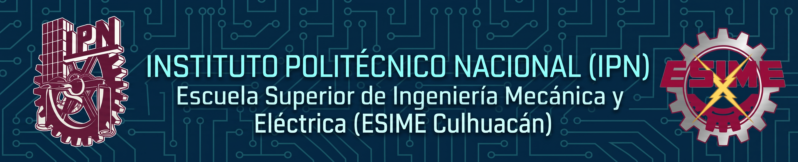

.png)
## ABOUT ME
- 🤓 I'm Ian ∴
- 🌍 I'm based in: México City
- 🎓 I am currently studying at university
- 🗣️ The languages ​​I speak are: Spanish, English and Nahuatl.

# ESTUDIOS

# SKILLS

                  

                  
